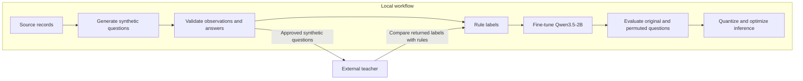

# Privacy-Constrained Synthetic Distillation

We turn locally held records into synthetic questions with checkable answers, fine-tune **Qwen3.5-2B**, and measure the deployment trade-offs. Our case study uses numerical understanding questions from USTBench's charging-station placement task, such as ranking candidate sites by distance, waiting time or charging time.

[中文](README.md) · [Method and entry points](docs/method.md) · [Results](docs/results.md) · [Reproduction](docs/reproduce.md)

## Workflow



The API teacher labeled **1,088 synthetic questions**. After recovering one truncated response, every teacher label agreed with the exact rule. The matched student runs below used rule labels, with **68 distinct supervision questions, 136 updates and three training orders** per source. [Teacher label audit](results/teacher-labels1088.json)

## Synthetic supervision

| Student training source | Original questions | Joint position and option permutation |
|---|---:|---:|
| Original records | 88.13% | 88.50% |
| Earlier generator | 89.63% | 90.15% |
| Revised generator | **89.80%** | 89.60% |

Mean accuracy over three training orders on the same **1,154 POI understanding questions**, with eight shared real demonstrations. This was a supplemental evaluation on a previously used Final split with checkpoints fixed before its first evaluation. The scores show comparable observed performance in this setting. [Per-order scores](docs/results.md#同题数补充评测) · [Aggregate data](results/matched68.json)

## Quantization and inference

One fixed synthetic-trained checkpoint, **NVIDIA L40S**, **72 questions** and eight synthetic demonstrations. Latency is the median for serial requests.

| Precision | Correct | Weight size | Peak PyTorch allocation | Median latency |
|---|---:|---:|---:|---:|---:|
| BF16 | 66/72 | 4.43 GB | 5.00 GB | **0.282 s** |
| bitsandbytes INT8 | **66/72** | **2.73 GB (−38%)** | 3.34 GB | 0.809 s |
| bitsandbytes NF4 | 61/72 | 1.98 GB (−55%) | 2.56 GB | 0.321 s |

INT8 trades latency for lower memory use. In a separate vLLM comparison with the full prompt, GPTQ INT4 scored **65/72** and reduced model-loading memory from **3.56 to 1.65 GiB** relative to BF16. [Quantization data](results/quantization72.json) · [FP8 and GPTQ results](docs/results.md#部署测量)

| vLLM BF16 setup | Median input tokens | Median latency | Correct |
|---|---:|---:|---:|
| Full prompt, cache off | 6,000 | 0.242 s | 66/72 |
| Deduplicated demonstrations, cache off | 3,851 (−36%) | 0.186 s | 66/72 |
| Deduplicated demonstrations, cache on | 3,851 (−36%) | **0.175 s (−28%)** | 66/72 |

Deduplicating the instructions retained the total score with one gain and one loss. For the same deduplicated prompt, cache on and off produced identical output tokens. [Paired prompt and cache results](results/prompt-cache72.json)

## Quick check

The local demo and aggregate checks only require Python and its standard library.

```bash
python3 examples/local_contract_demo.py
python3 tools/show_results.py
python3 tools/verify_release.py
```

Research components live in [`src/privacy_synth/`](src/privacy_synth/) and historical entry points in [`scripts/`](scripts/). Full GPU runs require the original manifests, authorized data and local model assets. See the scope notes for the road-planning failure analysis, public-proxy teacher calls and privacy limits. [Reproduction](docs/reproduce.md) · [Scope](docs/scope.md) · [USTBench](https://github.com/usail-hkust/USTBench) · [Third-party terms](NOTICE.md)
