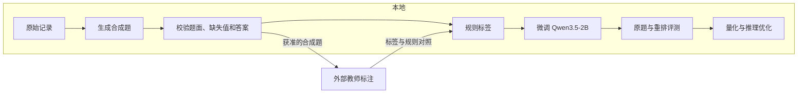

# Privacy-Constrained Synthetic Distillation

把本地原始记录转成可校验的合成题，用它们微调 **Qwen3.5-2B**，再测量量化、提示压缩和缓存带来的部署变化。我们的实测案例是 **USTBench 充电站选址中的数值理解题**，例如根据候选地点的距离、等待时间或充电时间排序。

[English](README.en.md) · [方法与代码入口](docs/method.md) · [完整结果](docs/results.md) · [复现指南](docs/reproduce.md)

## 流程



我们对 **1,088 道合成题**完成了 API 教师标注。补齐一条截断回答后，标签全部与精确规则一致。下表的学生训练使用规则标签，三个训练来源各用 **68 道独立监督题、136 次更新、三个训练顺序**。 [教师标注记录](results/teacher-labels1088.json)

## 合成训练效果

| 学生训练来源 | 原题准确率 | 同步重排位置与选项后 |
|---|---:|---:|
| 原始记录 | 88.13% | 88.50% |
| 旧生成器 | 89.63% | 90.15% |
| 新生成器 | **89.80%** | 89.60% |

同一批 **1,154 道理解题**，表中为三个训练顺序的平均值。各组共享 8 道真实示例。这是对已使用 Final 的补充评测，检查点在首次评测前已固定。原题与重排结果均支持合成训练在这一设置下接近有限的真实监督。 [逐顺序结果](docs/results.md#同题数补充评测) · [汇总数据](results/matched68.json)

## 量化与推理优化

固定同一个合成题微调检查点，在 **NVIDIA L40S、72 道原题、8 道合成示例**上测量正确数、导出权重和串行请求延迟。

| 精度 | 答对 | 权重大小 | PyTorch 峰值分配显存 | 单题中位延迟 |
|---|---:|---:|---:|---:|---:|
| BF16 | 66/72 | 4.43 GB | 5.00 GB | **0.282 秒** |
| bitsandbytes INT8 | **66/72** | **2.73 GB（−38%）** | 3.34 GB | 0.809 秒 |
| bitsandbytes NF4 | 61/72 | 1.98 GB（−55%） | 2.56 GB | 0.321 秒 |

INT8 省下约三分之一的峰值分配显存，代价是更高的延迟。vLLM 的 GPTQ INT4 在完整提示下取得 **65/72**，模型加载显存从 BF16 的 **3.56 GiB 降至 1.65 GiB**。 [量化数据](results/quantization72.json) · [FP8 和 GPTQ 明细](docs/results.md#部署测量)

| vLLM BF16 配置 | 输入 token 中位数 | 单题中位延迟 | 答对 |
|---|---:|---:|---:|
| 完整提示，缓存关 | 6,000 | 0.242 秒 | 66/72 |
| 示例去重，缓存关 | 3,851（−36%） | 0.186 秒 | 66/72 |
| 示例去重，缓存开 | 3,851（−36%） | **0.175 秒（−28%）** | 66/72 |

去重只合并 8 道示例中的重复说明，总正确数持平，包含一题答对、一题答错的互换。对同一个去重提示，缓存开关的输出逐 token 一致。 [提示与缓存配对结果](results/prompt-cache72.json)

## 快速查看

以下演示和汇总检查可在纯 CPU 上运行，Python 标准库即可。

```bash
python3 examples/local_contract_demo.py
python3 tools/show_results.py
python3 tools/verify_release.py
```

核心组件在 [`src/privacy_synth/`](src/privacy_synth/)，历史运行入口在 [`scripts/`](scripts/)。完整 GPU 实验需要原运行清单、合法数据和本地模型资产。道路规划的负面结果、历史公开代理调用与隐私结论的适用范围另有说明。 [复现指南](docs/reproduce.md) · [证据边界](docs/scope.md) · [USTBench](https://github.com/usail-hkust/USTBench) · [第三方条款](NOTICE.md)
